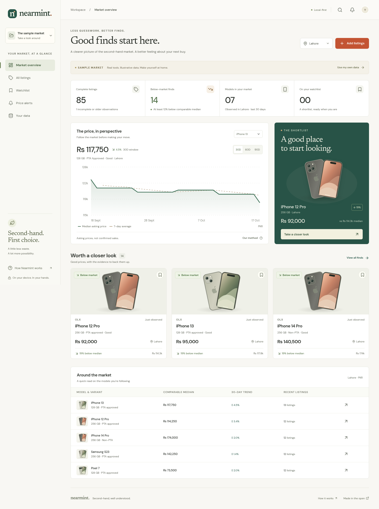

# Nearmint

**Second-hand, well understood.** A local-first price research workspace for used tech in Pakistan. Cream, terracotta, and forest green; no accounts or tracking.



## What works

- Responsive dashboard with model-specific 30/60/90-day price charts and 7-day averages.
- Deterministic parsing of messy iPhone, Samsung, Pixel, MacBook, Dell, and LG listing text, including storage, condition, city, and PTA status.
- Independent comparable medians, IQR outlier filtering, explicit evidence counts, and conservative deal labels.
- Private manual and CSV imports, canonical-URL deduplication, and append-only price observations.
- Search, sorting, category/PTA/condition/budget filters, saved listings, and local budget/discount alerts.
- Inspectable listing details, original descriptions, observation history, and a resale calculator including repairs, transport, and selling fees.
- IndexedDB persistence, full JSON backups and restoration, spreadsheet-safe CSV export, and an offline-capable installable PWA.
- Clearly separated, entirely synthetic sample data. Personal imports never use the sample market as pricing evidence.

This is a working **browser application**, built for GitHub Pages. It does not scrape marketplaces, confirm sales, run background collection jobs, or send server-side push alerts. Alerts are evaluated when the app opens and when the workspace changes. Data stays in the current browser; export a backup to move it to another device.

## Develop

Use Node.js 24 (see `.nvmrc`).

```sh
npm ci
npm run dev
```

Vite serves the project at the `/protify-prompt/` base path. Each cloud task already has an isolated checkout; use it directly without creating another worktree.

```sh
npm test             # calculation, parser, CSV, and backup tests
npm run build        # strict TypeScript + production build + service worker
npm run preview      # serve the production build
npm run test:e2e     # actual browser workflows, accessibility, responsive layout, offline
```

Browser tests use `/usr/bin/chromium` when present. Otherwise run `npx playwright install chromium` first. CI also installs the required Linux browser libraries. Set `PLAYWRIGHT_EXECUTABLE_PATH` to select a different Chromium binary.

## Import your listings

Use **Add listings** to paste an original listing title and asking price. Review the detected model, storage, PTA status, and condition before saving. Incomplete and damaged listings stay visible but are excluded from price benchmarks.

For bulk data, download the CSV template in the application or use [public/sample-listings.csv](public/sample-listings.csv). Its rows are illustrative. Required columns are `title` and `price`; supported columns are:

| Column        | Meaning                                                              |
| ------------- | -------------------------------------------------------------------- |
| `title`       | Original description, up to 500 characters                           |
| `price`       | Full asking price in PKR, e.g. `95000`, `95k`, or `1.2 lakh`         |
| `city`        | Lahore, Karachi, Islamabad, Rawalpindi, Faisalabad, or Other         |
| `source`      | Your own source label                                                |
| `seller`      | An optional nickname/reference, not a verified identity              |
| `url`         | Optional http/https listing URL; used to merge repeated observations |
| `observed_at` | Optional ISO date/time; defaults to import time                      |
| `condition`   | `excellent`, `good`, `fair`, `parts`, or `unknown`                   |
| `pta`         | `approved`, `non-pta`, `unknown`, or `n/a`                           |
| `storage`     | Storage capacity in GB, e.g. 128 or 1024                             |

Reusing a canonical URL adds observations to one listing, even if its title changes. Without a URL, source + seller + city + normalized original title identify a listing; price is also included when no seller is supplied. Different repost wording cannot be reliably linked without a stable URL or seller reference. No image- or identity-based fraud detection is claimed.

Malformed rows are reported in the import preview. Nothing is imported until the user chooses **Import**. An identical price at an identical timestamp is skipped. Importing an undated CSV again records a fresh observation without duplicating its listing identity. Each workspace supports up to 5,000 listings and 2,000 observations per listing; import files are capped at 10 MB.

## Pricing method

See [docs/methodology.md](docs/methodology.md), or **How Nearmint works** in the app. Asking prices are not completed-sale values. The app never equates a disappeared listing with a sale and does not use synthetic data to estimate personal listings.

## GitHub Pages

The production base path is `/protify-prompt/`. `VITE_BASE_PATH` can override it when hosting elsewhere. Hash navigation supports direct links without server rewrites, and all fonts and visual assets are self-hosted.

[The deployment workflow](.github/workflows/pages.yml) tests the application and deploys `dist` to Pages after a successful push to `main`. GitHub Pages must be enabled for the repository with **GitHub Actions** as its source. This repository is private, so Pages availability also depends on the repository owner's GitHub plan. Enabling Pages requires a repository token or integration with the relevant Pages/administration permission; ordinary source push access does not supply it.

Expected public URL, once Pages is enabled and deployment succeeds: `https://maaznpc.github.io/protify-prompt/`.

## Design references

Reviewed [Swappa's product guides](https://swappa.com/guide) for model and variant organization, [Back Market](https://www.backmarket.com/en-us) for condition-focused second-hand shopping, and [ChangeDetection](https://github.com/dgtlmoon/changedetection.io) for visible history and explicit watches. The interface, illustrations, and implementation are original; no logos, listing photos, or marketplace data were copied.

## Privacy and limitations

Your workspace is stored in IndexedDB on the site's origin. There is no backend, account, analytics, or remote data upload. The service worker caches only the static app shell. Browser storage can be evicted; JSON backups include listings, history, watchlists, and alerts. CSV includes all listing observations but not alert/watchlist settings. Restoring a backup replaces the current workspace after an explicit confirmation.

No application can establish device condition or seller legitimacy from a title. Verify the hardware and PTA status independently before a purchase. Budget matches do not imply a safe or profitable trade.

MIT license; see [LICENSE](LICENSE).
